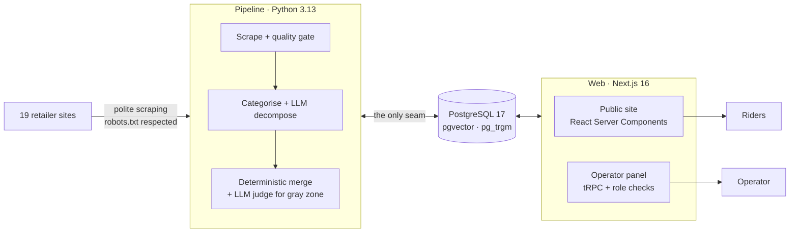

# Motopedia.cl

**A neutral price-comparison platform for the motorcycle market in Chile.** Gear, parts and bikes from 19 Chilean retailers, side by side, cheapest first, each price stamped with the date it was last checked.

🌐 **Live:** [motopedia.cl](https://motopedia.cl) · 📱 Installable as a PWA

> This repository is a **case study**, not the product's source code. The codebase is private. Here you'll find what the system does, how it is built, the decisions behind it, and what went wrong along the way. A code walkthrough is available on request in an interview.

**👉 The best demo is the real thing: [open motopedia.cl](https://motopedia.cl)** and search for a helmet, a tyre or a chain.

---

## The problem

Riders in Chile have no single place to compare prices. The offer is spread across dozens of online stores of uneven quality, and buyers don't even know every store that exists. Comparing means opening one tab per store, searching each catalog by hand, and still not knowing whether you saw the whole market.

It isn't a one-off cost. Riding generates recurring purchases (tyres, oil, chains, consumables), so the same friction comes back several times a year. Price comparison already exists in Chile, but only for consumer electronics.

The hard part is technical: every store names, categorises and formats its products differently. **Recognising that two listings from two stores are the same product**, and placing both in one shared taxonomy, is the core problem of any price comparator.

## What I built

| | |
|---|---|
| **Catalog** | ~18,000 products from 19 retailers, in four groups: gear, bikes, parts, accessories |
| **Product page** | An "offer ladder": only active offers with a real price, cheapest first, each linking to the store |
| **Search & filters** | Free-text search plus category, brand, store and price filters with server-side cross counts |
| **Price history** | Per-product history with a descriptive verdict that never tells you to buy or wait |
| **Workshops directory** | Operator-curated listings of repair shops and services |
| **Rider accounts** | OAuth sign-in, wishlist, daily price-drop alerts, moderated reviews (behind feature flags pending legal review) |
| **Operator panel** | Role-based admin to review, categorise, merge, publish and monitor scrapers |
| **Data pipeline** | Scraping, LLM-assisted standardisation, deterministic product matching, tiered price refresh, alerting |
| **Mobile** | Installable PWA with a phone-only install banner; Google Play listing (TWA) planned |

**Neutrality is the brand.** Motopedia sells nothing and recommends nothing. The ranking code never reads the sponsorship flag, and paid placements are shown as separate, labelled blocks, never as a position inside a list.

## Architecture at a glance

Two tiers in two languages share **one database and nothing else**: no HTTP, RPC or message bus between them. The web tier owns the schema; the pipeline reflects it at runtime and never migrates it. More in [docs/architecture.md](docs/architecture.md).

## Tech stack

| Layer | Technologies |
|---|---|
| **Web** | Next.js 16 (App Router, RSC), React 19, TypeScript (strict), tRPC v11, Drizzle ORM, Auth.js v5, Zod, Tailwind CSS v4, shadcn/ui |
| **Pipeline** | Python 3.13, uv, SQLAlchemy 2.0 Core, psycopg 3, httpx, APScheduler, Anthropic Claude API (Haiku / Sonnet), sentence-transformers |
| **Data** | PostgreSQL 17 with pgvector (768-dim embeddings, HNSW), pg_trgm (fuzzy search), pgcrypto |
| **Quality** | Vitest, Playwright + axe, pytest, ESLint, Prettier, Ruff, Black, mypy strict, pre-commit hooks |
| **Ops** | Docker, GitHub Actions CI, self-hosted PaaS on a single VPS, CDN/WAF edge, daily off-site DB backups, error tracking, staging environment |

## By the numbers

| | |
|---|---|
| Development period | May 2026 → today (solo) |
| Commits | 866 |
| Epics planned | 43 (6 later dropped by a scope decision) |
| User stories specified | ~190 |
| Recorded product & architecture decisions | 69 |
| Web tests | ~440 Vitest files (7,000+ cases) + 27 Playwright end-to-end specs, incl. accessibility |
| Pipeline tests | 87 pytest files, 1,000+ tests |
| Retailers integrated | 19 (launch goal was 8) |
| Infrastructure cost | a few tens of US dollars per month |

## Built with AI, on purpose

I built Motopedia as a solo developer working with AI agents (Claude Code) under a structured method, BMad Method: brief → PRD → architecture → epics and stories → implementation → adversarial review → retrospective. Every product decision was mine and is recorded in a decision log. The agents drafted, implemented and reviewed; CI, tests and multi-lens reviews caught them when they were confidently wrong, which happened.

The skill I'd highlight isn't "prompting". It's **running AI as an engineering team**: writing specs it can't misread, setting gates it can't skip, and knowing when to distrust its output. See [docs/ai-assisted-development.md](docs/ai-assisted-development.md).

## Read more

| Document | What's inside |
|---|---|
| [Architecture](docs/architecture.md) | System context, the database seam, request flow, auth layers, deployment |
| [Data pipeline](docs/data-pipeline.md) | Scraping, standardisation, matching, freshness tiers, alerting |
| [Key decisions](docs/decisions.md) | Seven decisions with context, options and consequences |
| [AI-assisted development](docs/ai-assisted-development.md) | The method, the human/agent split, and the guardrails |
| [Engineering practices](docs/engineering.md) | CI, testing strategy, code quality, environments |
| [Lessons learned](docs/lessons-learned.md) | What went wrong and what I changed because of it |

---

## 🇨🇱 En español

**Motopedia.cl es un comparador de precios neutral para el mercado de la moto en Chile.** Equipamiento, repuestos y motos de 19 tiendas chilenas, lado a lado, de menor a mayor precio, cada precio con la fecha en que se revisó por última vez.

> Este repositorio es un **caso de estudio**, no el código fuente del producto, que es privado. Aquí se explica qué hace el sistema, cómo está construido, qué decisiones lo definieron y qué salió mal en el camino. Puedo mostrar el código en una entrevista si se solicita.

### El problema

En Chile, quien anda en moto no tiene un lugar único donde comparar precios. La oferta está repartida en decenas de tiendas online y el comprador ni siquiera las conoce todas. Comparar significa abrir una pestaña por tienda, buscar a mano en cada catálogo y aun así no saber si vio todo el mercado. Además, las compras se repiten varias veces al año (neumáticos, aceite, cadenas), así que el problema también se repite.

El desafío técnico de fondo es que cada tienda nombra y clasifica sus productos a su manera. **Reconocer que dos fichas de tiendas distintas son el mismo producto** es el núcleo de cualquier comparador.

### Qué construí

- Catálogo de **~18.000 productos de 19 tiendas** (la meta de lanzamiento eran 8).
- Página de producto con la "escalera de ofertas", búsqueda con filtros, historial de precios y directorio de talleres.
- Cuentas de usuario con OAuth, lista de deseos, alertas diarias de baja de precio y reseñas moderadas.
- Panel de administración por roles para revisar, categorizar, fusionar y publicar.
- Pipeline de datos: scraping ético, estandarización asistida por LLM, fusión determinística de productos y actualización de precios por niveles.
- PWA instalable en el teléfono; la publicación en Google Play (TWA) es el siguiente paso.

**La neutralidad es la marca:** el código de ordenamiento nunca lee el indicador de patrocinio, y lo pagado se muestra en bloques separados y señalizados.

### Arquitectura

Dos capas en dos lenguajes (TypeScript y Python) que comparten **una sola base de datos PostgreSQL y nada más**. La capa web es dueña del esquema; el pipeline lo refleja y nunca lo migra. Todo corre en un solo servidor con integración continua, respaldos diarios, staging y monitoreo.

### Desarrollo asistido por IA

Construí Motopedia en solitario, trabajando con agentes de IA (Claude Code) bajo una metodología estructurada (BMad Method): brief, PRD, arquitectura, épicas e historias, implementación, revisión adversarial y retrospectiva. Todas las decisiones de producto fueron mías y quedaron registradas (69 decisiones). Los agentes redactaron, implementaron y revisaron; la CI, las pruebas y las revisiones los detuvieron cuando se equivocaban con total seguridad, cosa que pasó.

La habilidad que destaco no es "escribir prompts", sino **dirigir la IA como un equipo de ingeniería**: escribir especificaciones que no pueda malinterpretar, poner controles que no pueda saltarse y saber cuándo desconfiar de lo que entrega.

### Cifras

866 commits · 43 épicas · ~190 historias de usuario · 69 decisiones registradas · más de 8.000 pruebas automatizadas entre web y pipeline · costo de infraestructura de unas decenas de dólares al mes.

---

© 2026 Catriel Goldmann. All rights reserved. This repository contains documentation only; no license is granted to reproduce it.
