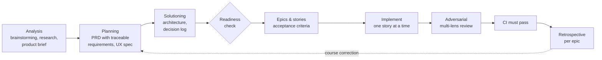

# AI-assisted development

[← Back to README](../README.md)

I built Motopedia as a solo developer working with AI agents (Claude Code). I'm stating it up front because it's a skill, not a shortcut. The agents wrote most of the code; the engineering was in deciding what to build, specifying it so it couldn't be misread, and building the gates that caught the agents when they were wrong.

## The method

The project follows **BMad Method**, an agile, phase-gated method for working with AI agents. Each phase produces a document that the next phase builds on, and specialised agent roles (analyst, product manager, architect, UX designer, developer, test architect, reviewer) each work from those documents.

| Artifact | Count |
|---|---|
| Recorded decisions | 69 |
| Epics planned | 43 |
| User stories with acceptance criteria | ~190 |
| Implementation-readiness reviews | 4 |
| Formal change proposals (when a plan was reversed) | 4 |

## Who did what

| Me | The agents |
|---|---|
| Product vision, scope and every product decision | Drafting briefs, PRDs, architecture and stories from my input |
| Choosing between the options presented | Laying out options, trade-offs and a recommendation |
| Hands-on validation of the real product | Implementing stories against acceptance criteria |
| Rulings when reviews disagreed | Writing tests, running reviews, fixing findings |
| Deciding when to cancel or cut scope | Auditing the impact of a change across all documents |
| Operating production | Writing runbooks and investigating incidents with me |

## The guardrails

AI output is fast and fluent, and sometimes confidently wrong. The process assumes that and checks for it:

1. **Specs before code.** Every story has acceptance criteria an agent can't reinterpret. Vague requirements were the main source of bad output, so precision went into the spec rather than into correcting code afterwards.
2. **Reviews by separate agents.** A story is reviewed by several independent lenses (adversarial, edge cases, verification gaps) that weren't involved in writing it.
3. **Claims are checked against the code.** One buildability review of the PRD found **six statements about the existing codebase that were false**, each written with full confidence. All were corrected before any story was built on them.
4. **CI is the final word.** Type checks, linters, more than 8,000 automated tests and end-to-end runs with each feature flag on. An agent can't merge on "it should work".
5. **Decisions are written down.** The decision log means any agent (or a future hire) can find out *why* something is the way it is, instead of re-litigating it.

## A concrete example

While specifying the price-history feature, the planning agent concluded that a flat price line meant "checked and unchanged", and told me so. Two days later an adversarial review traced the refresh code and showed that conclusion was wrong: unchanged items were never fetched. The decision log records the original claim as **withdrawn**, explains the error, and the fix became a pipeline feature (a genuine-observation timestamp). That is the loop working as designed. Details in [lessons-learned.md](lessons-learned.md#3-unchanged-is-not-the-same-as-observed).

## What I'd tell another team

- The bottleneck moves from typing code to **writing precise specifications and reviewing critically**.
- **Cheap code makes it tempting to build too much.** The hard skill is cutting: I cancelled a finished panel rebuild and 41 planned native-app stories.
- **Treat agent output like a strong junior's pull request:** usually good, occasionally wrong in a confident voice, and always reviewed.

---

### En español

Construí Motopedia en solitario, trabajando con agentes de IA (Claude Code) bajo **BMad Method**, una metodología ágil por fases: análisis, planificación (PRD), solución (arquitectura y decisiones), épicas e historias con criterios de aceptación, implementación, revisión adversarial y retrospectiva. Yo definí la visión, el alcance y todas las decisiones de producto, validé el producto real con mis manos y decidí cuándo cancelar o recortar. Los agentes redactaron, implementaron, probaron y revisaron. Los controles: especificaciones precisas antes del código, revisiones hechas por agentes distintos al que escribió, verificación de toda afirmación contra el código (una revisión encontró seis afirmaciones falsas sobre el código existente), CI con más de 8.000 pruebas como última palabra, y un registro de decisiones escrito. La lección principal: el cuello de botella pasa de escribir código a especificar con precisión y revisar con criterio.
