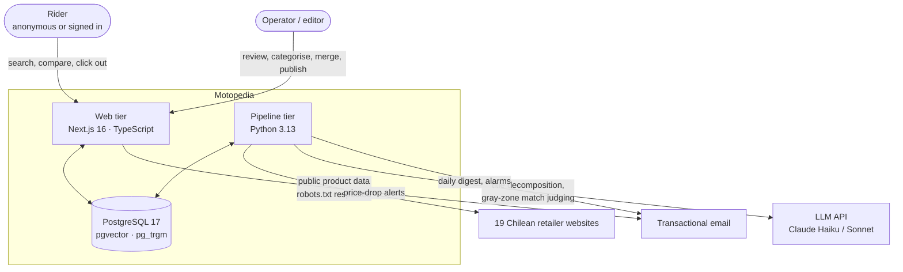
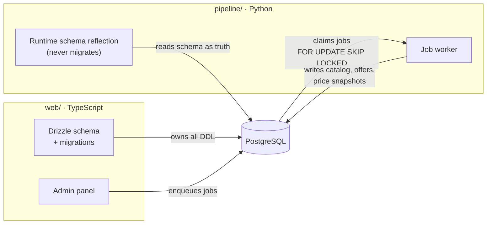
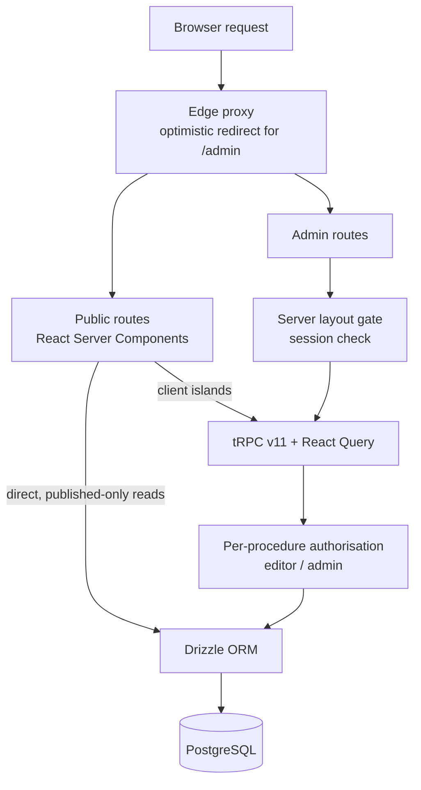
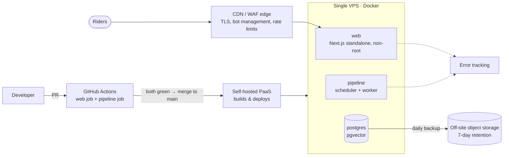

# Architecture

[← Back to README](../README.md)

Motopedia is a monorepo with **two tiers in two languages that share one PostgreSQL database and nothing else**. The design goal was simple: keep a system that one person can build, run and debug, without giving up CI, backups, staging or monitoring.

## 1. System context

## 2. The one seam: the database

There is **no HTTP, RPC or message-bus channel** between the web tier and the pipeline. Every interaction flows through tables.

| Shared through the database | Direction | Purpose |
|---|---|---|
| Catalog, offers, price snapshots | pipeline → web | What the public site serves |
| Job queue | web → pipeline | The admin panel enqueues scrapes; it never runs them |
| Job result summaries | pipeline → web | Run monitor, and the gate for automatic pruning |
| Retailer label → category map | operator ↔ pipeline | "Map once, inherit forever" categorisation |
| Merge verdicts | pipeline ↔ operator | Persisted decisions, so a pair is never judged twice |
| Brand vocabulary | pipeline ↔ operator | Canonical brands and aliases |
| Data-quality metrics | pipeline → web | Nightly snapshots shown on the admin dashboard |
| Locked fields | operator → pipeline | An operator's manual fix is never overwritten by a scrape |

**Why this shape.** A database seam gives transactional consistency for free, one backup to protect, and one place to look when something breaks. The cost is a set of contracts no compiler checks (schema drift, normalisation functions that must match in both languages). Those are guarded by a schema-verification command that CI runs against a freshly migrated database before the pipeline tests.

## 3. Web tier

- **Server-first rendering.** Public pages are React Server Components that only ever read products in `published` status. That status is the trust boundary of the whole site.
- **No client state library.** Filters, facets and sort order live in the URL, so every view is shareable and back-button safe.
- **Faceted search.** Each facet (category, sub-category, brand, store, price) gets a "would-match" count computed server-side with the other filters held fixed. The five aggregate queries run in parallel, and keyset pagination is used throughout.
- **Search.** Trigram indexes power fuzzy text search; 768-dimension embeddings with an HNSW index support product similarity.
- **Locale.** One locale (es-CL). Prices are stored as integer CLP, and the site ships structured data (JSON-LD) for search engines.

### Security in three layers

The admin panel is protected at three independent points, so a mistake in one doesn't open the door:

1. **Proxy:** an optimistic redirect for any `/admin/*` request without a session.
2. **Server layout:** the real wall. The page doesn't render without an authenticated session.
3. **Per procedure:** every tRPC operation declares the role it needs, and the error distinguishes "not signed in" from "not allowed".

Sessions are stateless JWTs that carry the user's id and role, so authorisation needs no database round-trip per request. There are exactly two operator roles (editor and admin), and hiding navigation is treated as UX only, never as security. Rider accounts use OAuth (Google, Facebook). Admin writes are non-destructive by default: an editor *marks* for deletion, an admin approves, and every write is appended to an audit log.

## 4. Pipeline tier

A Python package with a single CLI that is also the production process (`serve`: verify the schema, then run the scheduler loop forever).

- **Sealed modules.** Import-isolation tests enforce which modules may touch the database and which may import each other. Pure logic (merge rules, alarm evaluation) stays separate from I/O, which keeps the hard parts unit-testable.
- **SQLAlchemy Core, not an ORM.** The pipeline reflects the schema the web tier owns, so there are no duplicated model classes to drift.
- **One LLM call path.** Every model call goes through one function that handles truncation, token limits and API errors, with prompt caching enabled.

The full data flow is in [data-pipeline.md](data-pipeline.md).

## 5. Deployment

| Concern | Approach |
|---|---|
| Deploy | Merge to `main` → the PaaS builds and deploys. Migrations run when the web container boots. |
| Environments | Local Docker Compose (ports bound to loopback only) → staging (a production replica with a banner and `noindex`) → production |
| Backups | Daily PostgreSQL dump to off-site object storage, 7-day retention |
| Monitoring | Error tracking on both tiers, nightly data-quality snapshot, daily scraper alarm, daily email digest |
| Cost | A few tens of US dollars per month |

**Known limits I accept for now:** a single server means no high availability, and the pipeline image can lag the web image after a partial deploy, so a post-deploy check exists for that.

---

### En español

Dos capas (web en TypeScript y pipeline en Python) que comparten **una sola base de datos PostgreSQL y nada más**: no hay HTTP, RPC ni mensajería entre ellas. La web es dueña del esquema; el pipeline lo refleja en tiempo de ejecución y nunca lo migra. El panel de administración solo encola trabajos y el pipeline los ejecuta. Las páginas públicas son React Server Components que solo leen productos publicados, los filtros viven en la URL y la búsqueda usa trigramas y embeddings. El panel se protege en tres capas (proxy, layout del servidor y autorización por procedimiento) con sesiones JWT sin estado. Todo corre en un solo servidor con Docker, integración continua, staging, respaldos diarios fuera del servidor y monitoreo de errores.
