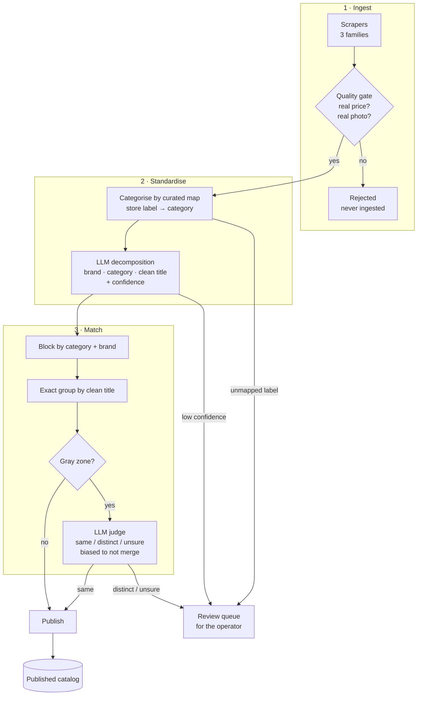
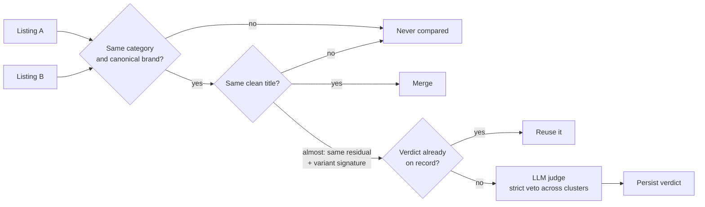
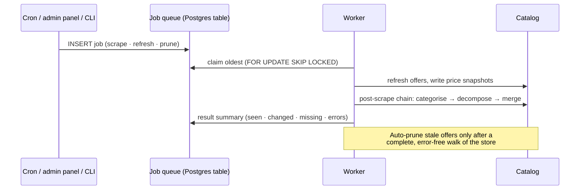

# Data pipeline

[← Back to README](../README.md)

The pipeline fills and maintains the catalog. It turns messy listings from 19 stores into one clean, comparable product catalog, keeps prices fresh, and raises an alarm when a store stops being read.

## 1. End-to-end flow

Only products that clear every gate are published automatically. Everything else lands in a review queue in the admin panel, so a human decides the doubtful cases.

## 2. Ingestion

- **Three scraper families cover all 19 stores:** Shopify's public product JSON, HTML stores walked through their sitemaps, and a shared structured-data (JSON-LD) parser for one e-commerce platform used by several stores.
- **Behaviour lives in two base classes**, so most store modules are declarative. Adding a new Shopify store takes about 30 lines.
- **Ethical scraping by design:** public data only, `robots.txt` checked on every request, one honest bot identity with a public page explaining it, and a 1.5–3 s delay per domain.
- **The quality gate sits at exactly two choke points** (full scrape and refresh), never inside individual scrapers, so no store can forget it. A product without a real price or a real photo (placeholders are detected) is never ingested. If the gate suddenly rejects most of a run, a circuit-breaker warning fires, because that usually means a store changed its HTML.

## 3. Standardisation

Two mechanisms reinforce each other:

1. **A curated label map.** Each store's own category label is mapped once to Motopedia's taxonomy by the operator, and every future product with that label inherits it. This is the primary categoriser, and it also runs inline when a product is written, so mapped products never wait.
2. **LLM decomposition.** A small, cheap model splits each title into brand, category, sub-category and a clean title, with a confidence score. Below the 0.75 threshold the item is retried once on a stronger model. Results are cached by a hash of the title, so an unchanged product never costs a second call. Brands resolve through an alias table to one canonical name.

## 4. Matching: deterministic first

**The non-functional requirement is zero wrong merges.** A wrong merge shows a rider a false price on the wrong product, which breaks the site's one promise. So the final decision uses **no similarity score**.

- Blocking by category and brand keeps comparisons small and makes cross-brand merges impossible by construction.
- Embeddings are used only to *propose* candidate pairs to the operator, never to merge.
- Every judge verdict is stored. A prior "same" sends future listings straight to the existing product; a prior "distinct" or "unsure" vetoes the pair for good.
- Fields the operator locked (for example, a hand-picked image) are never overwritten by the pipeline.

## 5. Jobs, scheduling and freshness

- **One queue for everything.** The cron, the admin panel and the CLI insert the same rows; only a `trigger_source` column tells them apart. A sweeper marks crashed jobs as failed after three hours.
- **Tiered refresh.** Stores are re-read according to what change signal they expose: every 6 h (Shopify, which reports `updated_at`), every 12 h (sitemap `<lastmod>`), or nightly (no change signal at all).
- **Honest freshness.** Every offer carries a "genuine observation" timestamp that moves only when a price was actually read from the product page, never on a heartbeat that merely saw nothing change. The rider sees how old each price really is. (Why this exists: [lessons-learned.md](lessons-learned.md#3-unchanged-is-not-the-same-as-observed).)
- **Safe pruning.** Offers that disappeared are deactivated only after a complete walk of the store with zero errors, and never sooner than the tier's time-to-live (14–28 days). A partial run can never wipe a store's catalog.

## 6. Observability

| Signal | When | What it catches |
|---|---|---|
| Error tracking | Always | Exceptions in both tiers |
| Data-quality snapshot | Nightly | Catalog health metrics, shown on the admin dashboard |
| Email digest | Daily | What every run did |
| Scraper alarm | Daily | Stores not fully read within twice their cadence, and stores where 25 %+ of offers went stale |

The alarm is stateless and read-only: every input is time-stamped, so "was this bad three days ago?" can be recomputed for any past instant. A problem is announced once and stays quiet until the store has been healthy for three daily checks, which avoids alert fatigue.

**Known gap, stated openly:** the alarm catches stores that stop being read, not prices that are read *wrong* after a store silently changes its markup. That one is still open.

---

### En español

El pipeline convierte fichas desordenadas de 19 tiendas en un catálogo limpio y comparable. Pasos: **scraping ético** (solo datos públicos, `robots.txt` respetado, bot identificado, pausas por dominio) con un **filtro de calidad** que rechaza todo producto sin precio o foto reales; **estandarización** con un mapa curado de etiquetas ("se mapea una vez, se hereda siempre") y descomposición por LLM con umbral de confianza; y **fusión determinística**, sin puntajes de similitud, porque el requisito es cero fusiones erróneas. Los casos dudosos los resuelve un juez LLM con sesgo a no fusionar, y sus veredictos quedan guardados. Una cola de trabajos en PostgreSQL (`FOR UPDATE SKIP LOCKED`) recibe tareas del cron, del panel y de la CLI por igual. Cada tienda se relee cada 6 h, 12 h o cada noche, y cada oferta muestra cuándo se leyó su precio de verdad. Una alarma diaria avisa cuando una tienda deja de leerse; los precios mal leídos siguen siendo un punto ciego reconocido.
