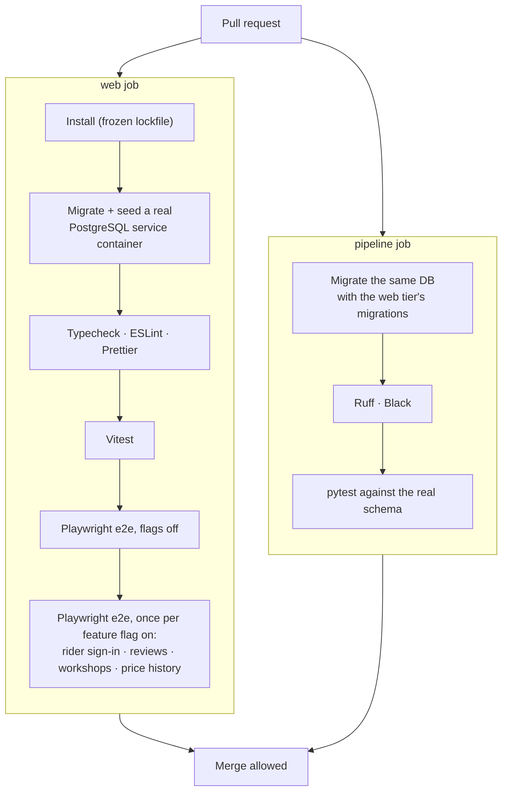

# Engineering practices

[← Back to README](../README.md)

## Continuous integration

Every pull request runs two jobs in parallel on GitHub Actions. **Both must pass before anything merges into `main`.**

Two details matter here:

- **The pipeline is tested against the web tier's migrations.** That is how CI catches schema drift across the two languages before it reaches production.
- **Each feature flag gets its own end-to-end run.** Features that ship dark (rider accounts, reviews and others) are tested both off and on, so turning one on later isn't the first time it runs.

## Testing strategy

| Tier | Tool | Scope |
|---|---|---|
| Web, unit & integration | Vitest (~440 files, 7,000+ cases) | Every tRPC router, auth, facets, structured data, components |
| Web, end-to-end | Playwright (27 specs) | Public pages, admin flows, metadata/sitemap/robots, **accessibility with axe** |
| Pipeline | pytest (87 files, 1,000+ tests) | Scrapers against fixtures, merge rules, scheduling, alarm logic |
| Architecture | Import-isolation tests | Sealed module boundaries in the pipeline |
| Opt-in suites | pytest markers | Live-site checks, regression sets and LLM-quality evaluations, run only on purpose |

The hardest logic (merge rules, alarm evaluation, freshness) is written as **pure functions**, separate from I/O, so it can be tested exhaustively without a network or a clock.

## Code quality

- **TypeScript strict**, including `noUncheckedIndexedAccess`. All input is validated with Zod at the API boundary.
- **mypy strict** on the pipeline (advisory), Ruff for linting, Black as the only formatter.
- **Pre-commit hooks** run the formatters and linters before a commit exists.
- **Frozen lockfiles** in CI for both pnpm and uv.

## Environments

| Environment | Purpose |
|---|---|
| Local | `docker compose up`: database, web and a pipeline schema check. Ports are bound to loopback only. |
| Staging | A production replica with a visible banner and `noindex`, used to rehearse deploys and data loads |
| Production | Deploys on merge to `main`; migrations run when the web container starts |

## Operations

- **Runbooks in plain language** for deploys, scraping, user management, staging, email and recovery, written so a future hire can run the system.
- **Non-destructive admin:** deletions need two roles (mark, then approve) and every admin write is audit-logged.
- **Secrets** live only in environment variables, never in the repository. `.env.example` templates document what each tier needs.
- **Privacy by default:** rider sign-in is OAuth only, consent is recorded with proof, account deletion is immediate, and features that handle personal data stay behind flags until the legal review for Chile's new data-protection law is done.

---

### En español

Cada pull request corre dos trabajos en paralelo (`web` y `pipeline`), ambos obligatorios para fusionar a `main`. El pipeline se prueba contra las migraciones de la capa web, lo que detecta desajustes de esquema entre los dos lenguajes. Cada funcionalidad oculta tras un interruptor tiene su propia corrida end-to-end. Pruebas: Vitest (más de 7.000 casos), Playwright (27 specs, con accesibilidad vía axe) y pytest (más de 1.000 pruebas). La lógica más difícil está escrita como funciones puras. Tipado estricto en TypeScript y Python, hooks de pre-commit, lockfiles congelados, staging como réplica de producción, runbooks en lenguaje simple y secretos solo en variables de entorno.
